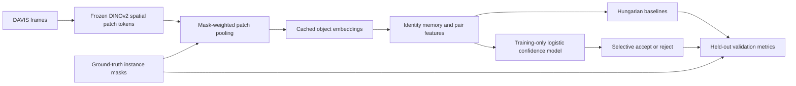

# Calibrated Selective Re-Identification for Occlusion-Robust Object-Centric Video Representations

This project tests whether calibrated association confidence and selective rejection reduce identity switches when objects reappear after absence. It is an empirical investigation of object identity association under occlusion; it does not claim to solve object discovery, segmentation, or general-purpose multi-object tracking.

The experiment uses DAVIS 2017 TrainVal 480p. Ground-truth instance masks are supplied as detections to isolate association quality from segmentation errors. The visual representation is frozen DINOv2 ViT-S/14 spatial patch features pooled inside each mask. A standardized logistic regression model estimates the probability that a memory identity and a current detection belong to the same object. The system can reject low-confidence Hungarian assignments and start a new predicted identity.

No DAVIS data, model checkpoints, extracted feature caches, or fabricated experimental results are stored in this repository.

## Research question and hypothesis

**Question:** Can calibrated association confidence and selective identity assignment reduce identity switches after object absence, compared with forced cosine matching and fixed-threshold matching?

**Hypothesis:** Allowing the association system to reject weak matches will reduce incorrect identity assignments. This may increase fragmentation, so precision, recall, coverage, identity switches, and fragmentation are reported separately.

## Method overview



Candidate features include cosine similarity, normalized center displacement, previous/current bounding-box IoU, symmetric area ratio, normalized frames since the last observation, and the cosine margin against competing identities. The feature calculation is separate from each decision rule. Detections receive deterministic local IDs from their geometry; ground-truth labels are kept outside association inputs and used only to generate calibration targets and evaluation labels.

The comparison includes:

- Cosine Hungarian assignment with forced acceptance.
- Cosine Hungarian assignment with a fixed threshold.
- Appearance and geometry Hungarian matching with a fixed score threshold.
- Logistic probability scores with Hungarian assignment and explicit low-confidence rejection.

The loader requires both official train and validation lists and rejects overlapping lists. The calibrator is fit from training-sequence candidate pairs only. Validation candidate pairs are used for final calibration analysis, not to fit the model or choose the configured operating threshold.

## Dataset

Download **DAVIS 2017 Semi-supervised TrainVal 480p** from the [official DAVIS downloads page](https://davischallenge.org/davis2017/code.html). The loader does not download the data and does not fall back to an unofficial mirror.

The expected files are:

```text
data/DAVIS/
├── ImageSets/2017/train.txt
├── ImageSets/2017/val.txt
├── JPEGImages/480p/<sequence>/<frame>.jpg
└── Annotations/480p/<sequence>/<frame>.png
```

The loader also recognizes a common additional directory level, for example `data/DAVIS/DAVIS/JPEGImages/480p`. It matches images and masks by filename stem, validates the official split lists, checks mask dimensionality and image/mask dimensions, and reports missing pairs, invalid frames, and skipped sequences. Background label `0` is excluded from object detections. An object absent from a valid mask frame simply has no detection in that frame.

DAVIS train and validation split files are both mandatory. If validation is absent, the loader stops instead of reusing training sequences. The official page provides the TrainVal images and annotations at 480p. [DAVIS 2017 downloads](https://davischallenge.org/davis2017/code.html)

## Colab setup

1. Upload or clone this repository into `/content/occlusion-aware-object-association`.
2. Download DAVIS TrainVal 480p from the official page and place it in Google Drive under `/content/drive/MyDrive/DAVIS`.
3. Open [`notebooks/occlusion_aware_association.ipynb`](notebooks/occlusion_aware_association.ipynb) in Colab and run from the top.
4. The notebook's configuration cell has one `DAVIS_ROOT` path and one `RUN_MODE` switch (`smoke` or `full`).

Colab supplies PyTorch. `requirements.txt` installs the project and its CPU-compatible data, scientific, plotting, and test dependencies without replacing PyTorch or downloading DINOv2 development tools. The official pretrained backbone is loaded with `torch.hub.load("facebookresearch/dinov2", "dinov2_vits14")`; its model weights are kept in the Torch Hub cache, outside this repository. [Official DINOv2 PyTorch Hub instructions](https://github.com/facebookresearch/dinov2#pretrained-backbones-via-pytorch-hub)

## Command-line workflow

Install dependencies in Colab or another Python environment that already has PyTorch:

```bash
python -m pip install -r requirements.txt
```

Set the DAVIS path, cache directory, and output directory in [`configs/default.yaml`](configs/default.yaml), then inspect the full TrainVal dataset:

```bash
python scripts/inspect_dataset.py --config configs/default.yaml --split all
```

Run a small feature and experiment smoke test:

```bash
python scripts/extract_features.py --config configs/default.yaml --split all --smoke-test
python scripts/run_experiments.py --config configs/default.yaml --smoke-test
```

Run complete feature extraction and evaluation:

```bash
python scripts/extract_features.py --config configs/default.yaml --split all
python scripts/run_experiments.py --config configs/default.yaml
```

Features are cached by sequence, frame, object label, backbone, and preprocessing settings. Repeated extraction skips compatible cache entries; a different backbone or preprocessing configuration produces different cache keys. Experiment runs receive unique output directories by default. To intentionally replace a named result directory, pass `--experiment-name NAME --overwrite`.

The calibrator can also be trained and saved separately. It consumes cached **training-split** features only:

```bash
python scripts/train_calibrator.py --config configs/default.yaml
```

The main runner refits the calibrator as part of its recorded experiment, runs the baselines and proposed method, performs the appearance/motion, memory-duration, and confidence-threshold analyses, and exports metrics and figures. To inspect an existing run:

```bash
python scripts/summarize_results.py /path/to/results/experiment_YYYYMMDDTHHMMSSZ
```

## Configuration and outputs

[`configs/default.yaml`](configs/default.yaml) contains the dataset root, official split names, DINOv2 backbone, preprocessing size and batch size, persistent cache path, memory gap, association thresholds and weights, logistic regression settings, ECE bins, confidence thresholds, memory-duration sweep, random seed, smoke-test limits, and output directory.

Each experiment directory contains:

```text
experiment_.../
├── config.yaml
├── metadata.json
├── metrics.csv
├── per_sequence_metrics.csv
├── association_predictions.csv
├── calibration_candidates.csv
├── training_calibration_candidates.csv
├── calibration_metrics.json
├── calibrator.joblib
├── calibrator.json
├── appearance_ablation.csv
├── calibration_ablation.csv
├── memory_duration_ablation.csv
├── occlusion_gap_metrics.json
├── dataset_loading_issues.json
├── experiment_summary.md
├── logs/run.log
└── figures/                 # PNG and PDF
```

Metadata records the UTC run time, commit hash when available, Python/PyTorch/CUDA/GPU information, exact train/validation sequence lists, backbone, random seed, smoke/full mode, and configuration. Output directories are unique by default; no results are overwritten unless a named run is explicitly marked for overwrite.

## Metrics and evaluation definitions

- **Identity switches:** a change in the predicted identity assigned to the same ground-truth object between consecutive observed frames. The first observation is not a switch. Reappearance changes count even after a gap.
- **Track fragmentation:** an identity change after at least one intervening valid image/annotation frame in which the object was absent. Intervals containing missing or invalid dataset frames are not counted as natural occlusion fragmentation.
- **Correct association:** an accepted Hungarian match whose memory identity's prior ground-truth owner equals the current detection's ground-truth label. This label is used after the decision for evaluation only.
- **Incorrect association:** an accepted match between different ground-truth objects.
- **Rejected association:** a Hungarian-selected assignment below that method's acceptance threshold. The detection starts a new predicted identity; the old memory remains until expiration.
- **Association precision:** correct accepted associations divided by all accepted associations.
- **Association recall:** correct accepted associations divided by current object observations for which a retained memory of that same object was available at frame start.
- **Association coverage:** accepted Hungarian assignments divided by all Hungarian-selected assignment decisions before threshold rejection. Accepted, rejected, and total assignment counts are exported.
- **False association rate:** incorrect accepted associations divided by all accepted associations.
- **Brier score and ECE:** computed only for logistic model probabilities on held-out validation candidate pairs. Raw cosine is a similarity, not a probability, so it is not given Brier/ECE scores. ECE uses uniform bins, configurable with a default of 10.
- **Precision–coverage curve:** a candidate-pair diagnostic over all held-out candidate pairs at configured probability cutoffs. It is distinct from assignment coverage above, which is calculated over Hungarian-selected decisions.
- **Natural occlusion gaps:** identity consistency between observations when every intervening frame has a valid annotation. No artificial observation removal is performed in this version.

IDF1 and HOTA are omitted because the project does not include a validated implementation for the oracle-mask association protocol. It does not report approximate values under those names.

## Results table template

The following is an empty reporting template, not an experimental result:

| Method | Identity switches | Fragmentations | Association precision | Association recall | Coverage | Brier | ECE |
|---|---:|---:|---:|---:|---:|---:|---:|
| Cosine forced | — | — | — | — | — | N/A | N/A |
| Cosine threshold | — | — | — | — | — | N/A | N/A |
| Motion + appearance | — | — | — | — | — | N/A | N/A |
| Calibrated selective | — | — | — | — | — | — | — |

## Reproducibility

Python, NumPy, PyTorch, and CUDA seeds are set from the central configuration. Logistic regression also receives an explicit scikit-learn `random_state`. Training candidate pairs are generated from online forced-cosine memories over training sequences; validation sequence names are checked against the training set before fitting. Validation threshold sweeps are diagnostics only. The configured operating threshold is fixed independently of validation results.

The current project includes a CPU-compatible synthetic end-to-end experiment that requires neither DAVIS nor a pretrained model. Run it with:

```bash
python -m pytest
```

Tests do not download pretrained weights or datasets. Full DAVIS runs and GPU inference require the official dataset, PyTorch, and (optionally) a CUDA runtime.

## Limitations

1. Ground-truth masks are detections, so segmentation quality is not evaluated.
2. DINOv2 features are frozen; this project does not train a new visual representation.
3. The confidence model is a relatively simple logistic regression model.
4. DAVIS alone does not establish generalization to other video domains.
5. Selective rejection can reduce incorrect associations while increasing fragmentation.
6. Higher association precision alone does not establish better tracking.
7. Calibration quality is evaluated separately from identity tracking metrics.
8. Validation sequences are never used to train the calibrator.
9. Artificially removed observations are not implemented or mixed into natural-occlusion results.
10. A successful experiment does not establish publication-level novelty.

See [`docs/limitations.md`](docs/limitations.md), [`docs/methodology.md`](docs/methodology.md), and [`docs/experimental_protocol.md`](docs/experimental_protocol.md) for the detailed protocol.

## Citation

See [`CITATION.cff`](CITATION.cff) for this repository. Cite the data and frozen backbone using their original publications:

- Jordi Pont-Tuset, Federico Perazzi, Sergi Caelles, Pablo Arbeláez, Alexander Sorkine-Hornung, and Luc Van Gool. “The 2017 DAVIS Challenge on Video Object Segmentation.” [arXiv:1704.00675](https://arxiv.org/abs/1704.00675).
- Maxime Oquab et al. “DINOv2: Learning Robust Visual Features without Supervision.” [arXiv:2304.07193](https://arxiv.org/abs/2304.07193).

This project describes an empirical investigation and makes no unsupported first-use or novelty claim.
# occlusion-aware-object-centric-learning
