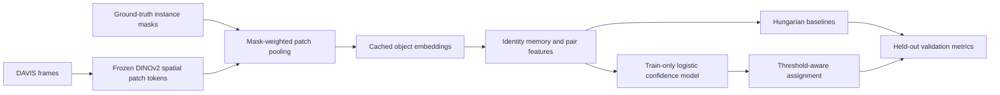

# Selective Identity Association After Object Absence

**Status: Ongoing research project**

This project studies whether a learned association-confidence model and selective rejection can preserve object identity when an object disappears from valid video annotations and later reappears. It focuses on the association stage of video tracking; it does not evaluate object detection, segmentation, or a complete tracking system.

The current pipeline uses DAVIS 2017 TrainVal 480p, frozen DINOv2 ViT-S/14 spatial features pooled inside ground-truth instance masks, an online identity memory, and Hungarian assignment. Ground-truth masks serve as oracle detections so the experiment isolates association behavior. The confidence model is a training-split-only standardized logistic regression over six appearance and geometry features.

## Research question

Can selective identity assignment based on learned pairwise probabilities reduce incorrect associations after mask-defined object absence, while balancing identity continuity, fragmentation, precision, and coverage?

The project is ongoing. Its current full validation run does **not** support the initial hypothesis that the logistic selective method reduces identity switches. Results below are reported as observed, including this negative outcome.

## Current results

The recorded full run evaluates all 30 official DAVIS validation sequences. It uses oracle masks as detections and has no independent test split. At the configured confidence threshold of 0.5:

| Method | Identity switches | Fragmentations | Association precision | Coverage |
|---|---:|---:|---:|---:|
| Cosine forced | 14 | 2 | 99.64% | 100.00% |
| Cosine threshold | 14 | 2 | 99.64% | 100.00% |
| Appearance + center + box overlap | **2** | **0** | **99.95%** | 100.00% |
| Logistic probability selective | 51 | 2 | 99.77% | 99.15% |

The selective method's identity switches increased from 29 at confidence threshold 0.3 to 51 at 0.5 and 83 at 0.7, as confidence rejections increased. In the appearance/geometry ablation, adding center displacement reduced switches from 14 to 4, and adding box overlap reduced them to 2. These results make geometry a promising direction in this setup; further controlled and replicated evaluation is needed.

The full run's held-out candidate-pair Brier score is 0.058 and ECE is 0.046 over 14,290 candidate pairs. These assess probability estimates; they do not imply improved identity tracking. Only six mask-defined reappearances occurred in the 1 to 15 frame gap bins, and none occurred in longer bins, so the current data are too sparse for strong gap-specific conclusions.

The detailed CSV, JSON, figure, and summary files are generated under the run directory in `results/`; those run artifacts are not committed. These figures summarize validation results, not independent test estimates.

## Method overview



The pair features are cosine similarity, normalized center displacement, bounding-box IoU, symmetric area ratio, normalized observation age, and a competing-identity similarity margin. Ground-truth labels are kept out of association inputs; they are used to build training targets and evaluate decisions. Thresholded assignment includes unmatched choices, so a detection without an accepted match starts a new predicted identity.

Compared methods include forced cosine matching, thresholded cosine matching, fixed-threshold appearance/geometry matching, and logistic-probability selective matching. The experiment also reports appearance/geometry and memory-duration ablations, calibration metrics, candidate and assignment precision/coverage curves, and full-sequence confidence-threshold replays.

## Scope and interpretation

- DAVIS masks are oracle detections. Segmentation quality, object discovery, detector recall, and end-to-end tracking performance are not measured.
- Mask-defined absence does not reveal whether an object was occluded or left the field of view. Results are described as absence/reappearance analysis.
- DAVIS TrainVal provides training and validation splits here, not an independent labeled test split. The calibrator is fit on training sequences only; thresholds are not selected using validation results.
- The pairwise model target is whether a memory identity was previously associated with the same ground-truth object. It is not identical to preserving the latest predicted track ID.
- The current calibration training replay uses thresholded cosine matching, while selective inference uses learned probabilities and geometry. This can create a train/inference memory-state mismatch.
- Results come from one validation run and do not establish generalization or publication-level novelty. Confidence intervals, broader datasets, and a controlled calibration comparison remain future work.

See [methodology](docs/methodology.md), [experimental protocol](docs/experimental_protocol.md), and [limitations](docs/limitations.md) for full definitions and assumptions.

## Dataset and setup

Download **DAVIS 2017 Semi-supervised TrainVal 480p** from the [official DAVIS page](https://davischallenge.org/davis2017/code.html). The loader does not download data. Both official split lists are required. The expected layout is:

```text
data/DAVIS/
  ImageSets/2017/train.txt
  ImageSets/2017/val.txt
  JPEGImages/480p/<sequence>/<frame>.jpg
  Annotations/480p/<sequence>/<frame>.png
```

Install the requirements in an environment that already has PyTorch:

```bash
python -m pip install -r requirements.txt
```

For the notebook, use a CUDA-enabled PyTorch kernel. In Colab, select a GPU runtime; for local use, install a PyTorch build compatible with the available CUDA driver. The notebook checks GPU availability and shows `tqdm` progress bars for long-running dataset and experiment stages. Configure the DAVIS path in [`notebooks/occlusion_aware_association.ipynb`](notebooks/occlusion_aware_association.ipynb) or [`configs/default.yaml`](configs/default.yaml).

The frozen backbone is loaded through the official DINOv2 Torch Hub entry point. The first load needs network access; checkpoints remain in the Torch Hub cache and are not stored in this repository. [DINOv2 pretrained-backbone instructions](https://github.com/facebookresearch/dinov2#pretrained-backbones-via-pytorch-hub)

## Command-line workflow

Inspect the full dataset:

```bash
python scripts/inspect_dataset.py --config configs/default.yaml --split all
```

Extract features and run a small smoke experiment:

```bash
python scripts/extract_features.py --config configs/default.yaml --split all --smoke-test
python scripts/run_experiments.py --config configs/default.yaml --smoke-test
```

For a full run, remove `--smoke-test`:

```bash
python scripts/extract_features.py --config configs/default.yaml --split all
python scripts/run_experiments.py --config configs/default.yaml
```

Feature-cache keys include source image/mask digests, preprocessing settings, and the exact backbone state-dict fingerprint. Compatible cached features are reused. Experiment outputs go to unique directories under `results/`; to replace a named result directory, use `--experiment-name NAME --overwrite`.

## Outputs and reproducibility

Each experiment directory contains the configuration and runtime metadata, aggregate and per-sequence metrics, pair-level predictions, detection decisions, calibration candidates and model, ablations, threshold analyses, loading issues, summary, and figures. Metadata includes the train/validation sequence lists, software and GPU versions, random seed, and Git commit when available.

To summarize an existing run:

```bash
python scripts/summarize_results.py results/experiment_YYYYMMDDTHHMMSSZ
```

A CPU-compatible synthetic test suite is available with `python -m pytest`. Tests do not download DAVIS or pretrained weights. Full feature extraction requires the dataset and a PyTorch runtime; CUDA is recommended.


## Citation

See [`CITATION.cff`](CITATION.cff). The project uses DAVIS and frozen DINOv2 features; cite their original publications:

- Jordi Pont-Tuset et al., "The 2017 DAVIS Challenge on Video Object Segmentation." [arXiv:1704.00675](https://arxiv.org/abs/1704.00675).
- Maxime Oquab et al., "DINOv2: Learning Robust Visual Features without Supervision." [arXiv:2304.07193](https://arxiv.org/abs/2304.07193).
